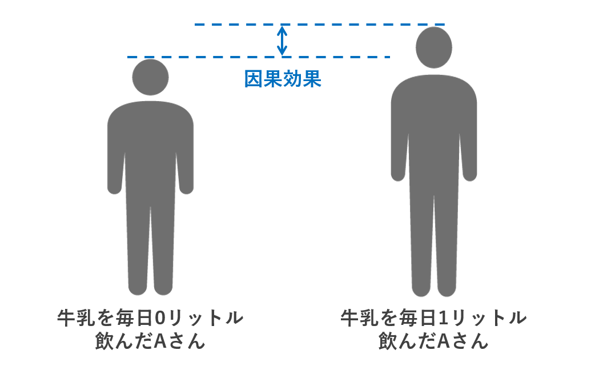
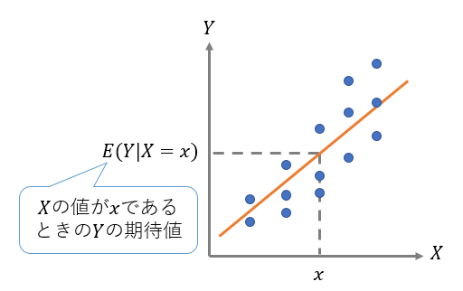

```{r include = FALSE}
knitr::opts_chunk$set(fig.align = 'center', message = F, warning = F)
# 日本語のグラフ文字が文字化け（□）しないよう、フォントの代替表示に対応したraggで描画する
knitr::opts_chunk$set(dev = "ragg_png")
```

# 本講義の目的

- 差の検定と回帰分析とマッチング法の基礎を学ぶ。
- データを自分で生成する方法を学ぶ。


# 平均処置効果

今回から、データの背後に潜む因果関係を推定する手法について学んでいく。

計量経済学においてよく用いられる考え方は潜在的結果の枠組み（potential outcome framework）である。
今回からこの枠組みに関する用語が登場するため、ここで軽く触れておく。

潜在的結果の枠組みのもとでは、因果関係の強さは「同じ個体が、処置を受けた時と処置を受けなかったときの結果の差」として考える。

<center></center>

## 潜在的結果

個体$i$が「処置を受けた場合（$X_i=1$）」と「処置を受けなかった場合（$X_i=0$）」の結果$Y_i$を、実際に処置があったかどうかに関わらず議論するために定めたものを**潜在的結果**（potential outcome）といい、それぞれ$Y_i(1), Y_i(0)$と書く。

実際の観察結果は$Y_i$とする

$$
Y_i = \left\{
\begin{array}{l}
Y_i(0) \ \text{if } X_i = 0 \\
Y_i(1) \ \text{if } X_i=1
\end{array}
\right.
$$

## 処置効果

個体$i$が処置を受けた時と受けなかったときの結果の差を**個体処置効果** （individual treatment effect: ITE）という。

$$
\tau_i = Y_i(1)-Y_i(0)
$$

処置を受けたときの結果と処置を受けなかったときの結果の両方を同時に観測することはできないため、ITE $\tau_i$は観測することはできない。


そこで、処置を受けた群とそうでない群における結果の平均の差を用いて処置効果を推定することを考える。

$$
\tau = E[Y(1) - Y(0)] = E[Y(1)] - E[Y(0)]
$$

これを**平均処置効果**（average treatment effect: ATE）という。

以下の節では、データを分析しながらATEの推定方法について学んでいく。


# データの用意

データから因果関係を推定するということは、データ生成過程（Data generating process: DGP）を理解しようという試みでもある。そこで今回は、データ生成過程があらかじめ分かっている架空のデータを自分で生成し、それを分析していく。

個人の所得$Y$と学歴$X$（大卒か否か）と能力$A$との関係について、以下のようなDGPを持つ架空データを次のように生成する（ただし$\varepsilon$は撹乱項）。このDGPは現実的なものではないが、理解しやすいようにできるだけ単純に設定したものを用いる。

$$
Y = 200 + 10A + 500X+ \varepsilon
$$

- サンプルサイズは10,000人
- 能力は0から100まで均等に分布する
- 能力が1上がると所得は10万円上昇する
- 能力が80 以上の約 2,000人中から約 1,000人がランダムに選ばれて大卒となる。
- 大卒だと所得が500万円上昇する
- 切片は200万円（能力=0、非大卒の平均給与）
  

```{r, echo=F}
pacman::p_load(DiagrammeR)

grViz("digraph dot{
graph[rankdir = LR]

node[shape = circle, fontname = 'Yu Gothic']

edge[fontname = 'Yu Gothic', fontsize = 10]
能力A -> 所得Y [label='10']
能力A -> 学歴X [label='A≧80からランダム抽出']
学歴X -> 所得Y [label='500']

{rank = same; 能力A; 学歴X}
}")

```

ここで、学歴$X$が所得$Y$に与える効果に興味があるとき、$X$を**処置変数**、$Y$を**アウトカム変数**と呼ぶ。また、$X$と$Y$に影響を及ぼすことが想定される能力$A$のような変数を**共変量/交絡要因/コントロール変数**と呼ぶ（分野によって呼び方やニュアンスが若干異なるが、ほぼ同じ意味で用いて問題ない）。

まず、上記のDGPに従うデータを生成する。なお、データ生成は、これまでに学習した内容と比較してやや高度なので、とりあえずは、ただコピペしてデータ生成するだけでも構わない。


```{r}
# 事前準備 --------------------
# パッケージの読み込み
pacman::p_load(tidyverse, modelsummary, MatchIt, cobalt, estimatr)

# 乱数の種を固定（同じ種からは常に同じ乱数が生成される。0を他の数値に変えると異なる乱数となる。）
set.seed(0)

# データの生成 ----------------
# n:サンプルサイズ
n <- 10000

# 能力は0から100まで均等に分布。#runifは一様分布を発生させる関数。標本規模n、最小値0、最大値100
ability <- runif(n, min = 0, max = 100) 

# IDとabilityをデータフレームに格納する。
# 以下の"tibble()"はtidyverseにおけるデータフレームを作成する関数。
# 代わりに"data.frame()"を用いても構わない。
df <- tibble(ID = 1:n, ability)

# 大卒ダミーの作成
# 能力が 80 以上の約 2000人の中から約 1000人をランダムに選んで大卒にする。
# dfからdplyr::filter()で抽出し、slice_sample()でさらに半分をランダムに抽出する。

university_df <- df |> filter(ability >= 80) |> 
                        slice_sample(prop = 0.5) # 大卒の人

# university_df のデータフレームに、universityという変数を作成し、すべて1とする。
university_df <- university_df |> 
                      dplyr::mutate(university = 1)

## なお、university_df["university"] = 1でも作成可能

# dfからdplyr::anti_join()を用いて"university_df"とマッチしなかった人を抽出する。
no_university_df <- anti_join(df, university_df, 
                              by = c("ID","ability")) # 大卒ではない人

# no_university_dfのデータフレームに、universityという変数を作成し、すべて0とする。
no_university_df <- no_university_df |> 
                      dplyr::mutate(university = 0)

## なお、no_university_df["university"] = 0でも作成可能

# university_dfとno_university_dfを、dplyr::bind_rowsを用いて結合してあたらしいdfとし、ID順で並べる
df <- bind_rows(university_df, no_university_df) |>  # 両者を結合
      arrange(ID) # ID順に並べる

# 所得変数（income)の作成：上記のDGP(母集団回帰モデル）に基づいて生成
df <- df |> mutate(income = 200 + 10*ability + 500*university + rnorm(n, mean = 0, sd = 50)) # 誤差項は平均=0、標準偏差=50

# 最初の6行
head(df)
```

生成したデータを用いて、能力(`ability`)と所得(`income`)との関係をプロットすると次のようになる。

```{r}
# 大卒か否かのラベルをデータフレームに加える
df <- df |> mutate(edu_label =
                      case_when(university == 1 ~ "Grad.", 
                                university == 0 ~ "Not grad."))

# 散布図を描く with 大卒ラベル
ggplot(df, aes(x = ability, y = income, color = edu_label)) + 
         geom_point(alpha = 0.5)+ 
         labs(title = "Ability and Income")
```


# 差の検定


以下では、上記のように生成したデータを、（データ生成過程を知らない）観察データとみなして分析する。分析目標は、「大学を卒業することが、所得をどれだけ上昇させるのか」という「因果効果」の推定である。

まず、学歴と所得分布の関係を箱ひげ図で表示すると、以下のようになる。

```{r}
# plot（箱ひげ図）
ggplot(df, aes(x = edu_label, y = income)) +
  geom_boxplot(alpha = 0.7) +
  labs(title = "Income distribution by university education")
```

大卒と非大卒の所得の平均には統計学的に有意な差があるかどうかを$t$検定によって調べる。

```{r}
# 大卒
grad_df <- df |> filter(university == 1)
# 非大卒
not_grad_df <- df |> filter(university == 0)

# それぞれのincomeを比較
t.test(x = grad_df$income, y = not_grad_df$income)
```

大卒の平均所得が約`r round(mean(grad_df$income),0)`万円、非大卒の平均所得が約`r round(mean(not_grad_df$income),0)`万円であり、1%有意水準でも有意な差があることがわかった。

ただし、ここで「大卒になることで、所得が両者の平均の差である約`r round(mean(grad_df$income) - mean(not_grad_df$income), 0)`万円だけ上昇する」と結論付けることはできない。例えば、学歴と所得の両方に影響を与える交絡要因がある場合、大卒と非大卒の所得差には、このような交絡要因の影響が反映されてしまう。

ここで、自分がこのデータの「真のデータ生成過程」を知っていることを思い起こそう。本データにおいては、所得$Y$が上がる要因には学歴$X$以外にも能力$A$という要因があった。そして、能力$A$は所得$Y$だけでなく、学歴$X$にも影響を与えていた。したがって、約`r round(mean(grad_df$income) - mean(not_grad_df$income), 0)`万円という所得差は、学歴（大卒）による所得上昇効果だけでなく、能力による所得上昇効果も混在している。


# （参考）セレクション・バイアスと処置割り当ての独立性

## セレクション・バイアス

前節で行った方法が潜在的結果の枠組みにおいてどう表されるか示す。
前節の方法は、観測できた各群の結果の平均の差

$$
E[Y(1)|X = 1] - E[Y(0)|X = 0]
$$

によってATEを推定する方法である。

これは$E[Y(0)|X = 1]$を足して引いて整理すると、次のようになる

$$
\begin{align}
E[Y(1)|X = 1] - E[Y(0)|X = 0]
&= E[Y(1)|X = 1] - E[Y(0)|X = 1] + E[Y(0)|X = 1] - E[Y(0)|X = 0]\\
&= \underbrace{E[Y(1) - Y(0)|X = 1]}_{\text{ATT}}
  + \underbrace{E[Y(0)|X = 1] - E[Y(0)|X = 0]}_{\text{Selection Bias}}\\
\end{align}
$$

$\text{ATT}$は**処置群における平均処置効果**（average treatment effect on the treated）である。話を単純化するために処置効果が処置群と対照群で平均的に等しい（$\text{ATT}=\text{ATE}$）と仮定すると、上記の単純な差による推定量は$\text{ATE} + \text{Selection Bias}$であり、セレクション・バイアスの分だけATEから乖離する推定量であることがわかる。


## ランダム化比較試験による推定

もし処置の割当$X$が無作為（ランダム）であれば潜在的結果$Y(0), Y(1)$とは独立

$$
\newcommand{\indep}{\mathop{\hspace{0.1em} \perp\!\!\!\perp \hspace{0.1em}}}
(Y(0), Y(1)) \indep X
$$

となる。その場合、

$$
E[Y(0)| X = 0] = E[Y(0)]\\
E[Y(1)| X = 1] = E[Y(1)]
$$

になるため、各群の平均の差$E[Y(1)|X = 1] - E[Y(0)|X = 0]$でATEを推定することができる。

そのため、もしも分析対象のデータが処置をランダムに割り振った実験によって得られたデータである場合、両群の平均値の差をATEの推定値に使うことは妥当であると考えられる。
しかし、今回のデータは処置の割り当てがランダムではなく条件を満たさないため、この方法を使用することはできない。


## 交絡要因の統制による推定

**交絡要因**（confounder）$A$を条件付けた下で、処置の割当$X$と結果$Y(0), Y(1)$が独立

$$
\newcommand{\indep}{\mathop{\hspace{0.1em} \perp\!\!\!\perp \hspace{0.1em}}}
(Y(0), Y(1)) \indep X | A
$$

であるという条件を、**無交絡性**（unconfoundedness）という。無交絡性が成立するとき、平均での独立性

$$
E[Y|X=0, A] = E[Y(0)|X, A] = E[Y(0)|A]\\
E[Y|X=1, A] = E[Y(1)|X, A] = E[Y(1)|A]
$$

が成立する。

そこから共変量について期待値をとればATEが推定できる。

$$
E_{A}( E[Y(1) - Y(0)|A] ) = E[Y(1) - Y(0)]
$$

条件付き期待値を推定する方法は次節以降で学んでいく。


# 回帰分析

## 回帰分析と条件付き平均値

平均値の差の検定では、条件付き期待値$E(変数|条件)$の記法を使って表現すると、大卒者の所得の期待値$E(Y|X=1)$と非大卒者の所得の期待値$E(Y|X=0)$の差

$$
E(Y|X=1) - E(Y|X=0)
$$

を推定していた。

しかしこの「差」においては、能力がどんな人であれ、大卒であるかどうかという点のみを条件に比較することになり、それが交絡要因である能力$A$による推定バイアスを生じさせていた。

そこで、イメージとしては、

- 能力$A=80$の人の中で、大卒($X=1$)の所得の条件付き期待値$E(Y|X = 1,A = 80)$と非大卒($X=0$)の所得の条件付き期待値$E(Y|X = 0,A = 80)$を比べる
- 能力$A=81$の人の中で、大卒($X=1$)の所得の条件付き期待値$E(Y|X = 1,A = 81)$と非大卒($X=0$)の所得の条件付き期待値$E(Y|X = 0,A = 81)$を比べる
- 能力$A=82$の人の中で...
- 能力$A=83$の人の中で...

といったように、新たに条件を追加して能力$A$の値を一定にした下で大卒と非大卒の所得を比較していけばよいと考えられる。

回帰分析の予測値$\hat{Y}$は、説明変数を$X,A$とすると、これらの説明変数の条件付き期待値$E(Y|X,A)$の推定値である。そのため、$E(Y|X = x,A = a)$のように、複数の説明変数で条件付けた下での期待値を推定することができる。これを利用して学歴$X$が所得$Y$に与える効果を推定することができる。

<center></center>


## すべての変数が入手可能な場合

もし、手元に所得$Y$、能力$A$、学歴$X$のデータがあるならば、

$$
Y = \beta_0 + \beta_1 A + \beta_2 X + u
$$

という回帰モデルによって係数$\beta_0,\beta_1,\beta_2$を推定できる。


```{r}
OLS_true_model <- lm(formula = income ~ ability + university, 
                     data = df)

modelsummary(OLS_true_model, 
             stars = TRUE, 
             gof_omit = "AIC|BIC|Log.Lik|RMSE")
```

能力（`ability`）、学歴（`university`）、切片（`(Intercept)`）の係数推定値は、冒頭のDGPで設定したパラメータとほとんど一致する。すなわち、バイアスのない推定値となっている。

ここで、上述したような、「能力$A=a$の人の中で、大卒($X=1$)の所得の条件付き期待値$E(Y|X = 1,A = a)$と非大卒($X=0$)の所得の条件付き期待値$E(Y|X = 0,A = a)$を比べる」というのは、下図の二つの回帰直線の「縦の差を測る」ことに相当する。一定の条件の下で、ここでの「縦の差」は、学歴が所得に与えた「**平均処置効果**」の推定値とみなすことができる。

```{r}
# 散布図と回帰直線を描く with 大卒ラベル
ggplot(df, aes(x = ability, y = income, 
               color = edu_label, 
               group = edu_label)) + # groupごと
         geom_point(alpha = 0.5)+ 
         geom_smooth(method = "lm", color = "black") +  # 回帰直線
         labs(title = "Ability and Income")
```

## 入手不可能な変数がある場合

実際には、学歴$X$と所得$Y$に影響を及ぼす能力$A$を正確に観察・測定することは難しい。そこで、能力$A$の変数が入手できない場合を想定し、上記の回帰式から$A$の項を除いた単回帰モデル

$$
Y = \beta_0 + \beta_1 X + u
$$

を推定するとどうなるだろうか。

結果は以下のようになる。

```{r}
OLS_missing_A <- lm(formula = income ~ university, 
                    data = df)
modelsummary(OLS_missing_A, 
             stars = TRUE, 
             gof_omit = "AIC|BIC|Log.Lik|RMSE")
```

この推定結果を因果的に解釈すると、「大卒になることによる所得上昇の効果」は、約`r round(OLS_missing_A$coefficients[2], 0)`（万円）と推定されたことになる（なおこの値は、上記の「差の検定」における大卒と非大卒の平均所得差と等しい）。すなわち、データ生成時に設定した真の値500よりも過大に推定されている。

このように、正しく推定するために必要な変数（能力$A$）が考慮されないことによる推定量・推定値の偏りを**欠落変数バイアス**（omitted variable bias）という。

# マッチング法

前節において、交絡要因である能力$A$の影響を除去したいときには、

- 能力$A=a$の人の中で、大卒($X=1$)の所得の条件付き期待値$E(Y|X = 1,A = a)$と非大卒($X=0$)の所得の条件付き期待値$E(Y|X = 0,A = a)$を比べる

という作業を行えばよいと述べた。そして、能力$A$を説明変数に加えた回帰分析は、このような作業を行っていると解釈できることも説明した。

マッチング法は、このような「条件($A$)を揃えた上での処置群($X=1$)と対照群($X=0$)の間でのアウトカム($Y$)の比較」を、いわば、そのまま行う分析手法である。言い換えると、マッチング法とは、共変量ベクトルが同一あるいは近しい個体を、処置群と対照群から「マッチング」させた上で両者のアウトカムの差を計算し、その全体での平均値を**平均処置効果**の推定値とみなす方法である。

なお、共変量ベクトルと処置変数のデータを用いて「処置を受ける確率」（傾向スコア）を推定した上で、この推定された傾向スコアを用いてマッチングする方法を「傾向スコアマッチング」という。この手法はマッチング法以上に広く使用されてきた。傾向スコアマッチングについては、次節の参考で扱う。

マッチング法は、Rでは`{MatchIt}`パッケージの`matchit()`関数で実行できる。

マッチングも回帰分析と同じで、必要な共変量が入手できるかどうかによって、推定バイアスの有無や程度に違いがでる。

今回の場合、能力$A$が入手できる場合は、これを唯一の共変量として、次のようにマッチングを行うことができる。

```{r}
# 最近傍マッチング（マッチングの方法の１つ）
match_nn <- matchit(university ~ ability,   # 処置変数 ~ 共変量
                    data = df,
                    method = "nearest",     # 最近傍マッチング
                    distance = "euclidean", # 共変量の値の差（距離）が最も小さい人を相手にする
                    estimand = "ATT",       # 処置群における平均処置効果（ATT）を推定
                    replace = TRUE)         # 同じ非大卒者を何度でも相手にしてよい（復元マッチング）
match_nn
```

`matchit()`の最近傍マッチングは、大卒者（処置群）の一人ひとりについて、非大卒者（対照群）の中から能力が最も近い人を探してマッチング相手にする。そのため、推定対象は**処置群における平均処置効果**（average treatment effect on the treated: ATT）、つまり「大卒者にとっての大卒の効果」になる（`estimand = "ATT"`）。今回のデータでは大卒の効果が全員500（万円）で一定なので、ATTとATEは一致する。なお、ATEを推定するには非大卒者についても大卒者の中から似た人を探す必要があるが、最近傍マッチング（`method = "nearest"`）はこれには対応していない。

`replace = TRUE`は、同じ非大卒者を何人の大卒者のマッチング相手にしてもよいという指定（**復元マッチング**）である。

マッチングによって大卒者と非大卒者の共変量がそろったかどうか（**バランス**）は、{cobalt}パッケージの`bal.tab()`関数で確認できる。

```{r}
bal.tab(match_nn, un = TRUE, disp = "means")
```

- `M.0`は非大卒者の平均、`M.1`は大卒者の平均で、`Un`はマッチング前、`Adj`はマッチング後の値である。
- `Diff`は**標準化平均差**（平均の差を標準偏差で割ったもの）で、絶対値が0.1未満ならバランスがとれているとみなすのが一般的な目安である。

マッチング前（`Un`）は非大卒者と大卒者の能力の平均が大きく異なるが、マッチング後（`Adj`）は、非大卒者の平均が大卒者の平均とほぼ同じになっている。大卒者一人ひとりに似た非大卒者を選んでいるので、非大卒者のほうが大卒者に合わせてそろうのである。

最後に、マッチング後のデータを`match.data()`で取り出し、所得を大卒ダミーに回帰すると、ATTの推定値が得られる。復元マッチングでは同じ非大卒者が複数回選ばれるので、その回数に応じた重みが`weights`列に入っており、これを使って重みをつけた回帰を行う。標準誤差には、第4回で学んだロバスト標準誤差を使う（標準誤差の計算方法については、[次節の解説](#ps-se)も参照）。

```{r}
md_nn <- match.data(match_nn)  # マッチング後のデータ

fit_nn <- lm_robust(income ~ university, 
                    data = md_nn, 
                    weights = weights,  # マッチングの重み
                    se_type = "HC1")    # ロバスト標準誤差
summary(fit_nn)
```

推定値は約`r round(coef(fit_nn)["university"], 1)`（万円）であり、設定した500（万円）に非常に近い値となっている。

# （参考）共変量が複数ある場合：回帰分析・マッチング・傾向スコア

これまでの例では、交絡要因（共変量）は能力$A$の1つだけだった。しかし現実には、学歴と所得の両方に影響を与える要因は複数あると考えられる。そこでこの節では、共変量を3つに増やしたデータを生成し、

1. 重回帰モデル
2. マッチング（共変量そのものを使ったマッチング）
3. 傾向スコアマッチング（{MatchIt}パッケージ）
4. 傾向スコアを使ったIPW（逆確率重み付け、{WeightIt}パッケージ）

という4つの方法で、大卒が所得に与える効果を推定して比較する。

## データの用意 {#ps-data}

以下のようなDGPを持つ架空データを生成する。

- サンプルサイズは10,000人
- 共変量は次の3つ
    - 能力$A$：0から100まで均等に分布する
    - 親の所得$P$：200万円から1000万円まで均等に分布する
    - 都市部出身ダミー$U$：半数が都市部出身（$U=1$）
- 大卒になる確率は、能力が高いほど、親の所得が高いほど、都市部出身であるほど高くなる。具体的には、大卒になる確率$e$を次のロジスティック関数で決める（$e$は0から1の間の値をとる）。

$$
e = \frac{1}{1 + \exp\{-(-4 + 0.04A + 0.003P + 0.6U)\}}
$$

- 所得$Y$は次の式で決まる。大卒の効果は全員500万円で一定なので、ATE（およびATT）は500万円である。

$$
Y = 200 + 10A + 0.5P + 100U + 500X + \varepsilon
$$

```{r, echo=F}
grViz("digraph dot{
graph[rankdir = LR]

node[shape = circle, fontname = 'Yu Gothic']

edge[fontname = 'Yu Gothic', fontsize = 10]
能力A -> 学歴X
親の所得P -> 学歴X
都市部出身U -> 学歴X
能力A -> 所得Y [label='10']
親の所得P -> 所得Y [label='0.5']
都市部出身U -> 所得Y [label='100']
学歴X -> 所得Y [label='500']
}")
```

なお、前節までのデータは「能力が80以上の人の中からだけ大卒が選ばれる」というDGPだったため、能力が80未満で大卒の人は一人もいない。このように「ある共変量の値の人が処置を受ける確率が0（または1）」になっていると、比較相手がいないため、後述する傾向スコアを使った方法は使えない（傾向スコアが0から1の間に収まり、処置群と対照群が重なり合っていることを**オーバーラップ**という）。そこでこの節では、大卒になる確率がなめらかに変化する上記のDGPを使う。

```{r}
# 乱数の種を固定
set.seed(1)

# n:サンプルサイズ
n <- 10000

# 共変量を生成し、大卒になる確率（ps_true）に従って大卒ダミーを、DGPに従って所得を生成する
df_multi <- tibble(
  ability = runif(n, min = 0, max = 100),         # 能力
  parent_income = runif(n, min = 200, max = 1000), # 親の所得
  urban = rbinom(n, size = 1, prob = 0.5)          # 都市部出身ダミー
) |>
  mutate(
    ps_true = plogis(-4 + 0.04 * ability + 0.003 * parent_income + 0.6 * urban), # 大卒になる確率（plogis()はロジスティック関数）
    university = rbinom(n, size = 1, prob = ps_true),                           # 確率ps_trueで1になる大卒ダミー
    income = 200 + 10 * ability + 0.5 * parent_income + 100 * urban +
             500 * university + rnorm(n, mean = 0, sd = 50)                      # 所得
  )

head(df_multi)
```

大卒者と非大卒者の平均所得の単純な差は以下のとおりで、真の値500よりもかなり大きい。大卒者のほうが、もともと能力や親の所得が高く、都市部出身が多いためである。

```{r}
# 単純な平均の差
naive <- mean(df_multi$income[df_multi$university == 1]) - 
         mean(df_multi$income[df_multi$university == 0])
naive
```

## 重回帰モデル {#ps-ols}

3つの共変量をすべて説明変数に加えた重回帰モデルを推定する。

```{r}
ols_multi <- lm(income ~ university + ability + parent_income + urban, 
                data = df_multi)

modelsummary(ols_multi, 
             stars = TRUE, 
             gof_omit = "AIC|BIC|Log.Lik|RMSE")
```

`university`の係数は約`r round(coef(ols_multi)["university"], 1)`であり、真の値500に近い。他の係数も、DGPで設定した値（10、0.5、100）に近い。

## マッチング {#ps-match}

前節と同じ`matchit()`関数で、3つの共変量をすべて指定する。

```{r}
match_cov <- matchit(university ~ ability + parent_income + urban, # 処置変数 ~ 3つの共変量
                     data = df_multi,
                     method = "nearest",       # 最近傍マッチング
                     distance = "mahalanobis", # マハラノビス距離が最も小さい人を相手にする
                     estimand = "ATT",
                     replace = TRUE)
bal.tab(match_cov, un = TRUE, disp = "means")
```

能力（0〜100）と親の所得（200〜1000）では値の大きさがまったく異なるので、値の差をそのまま足し合わせた距離（`distance = "euclidean"`）を使うと、親の所得の差ばかりが重視されてしまう。そこで、各共変量のばらつき（分散）の違いを調整した**マハラノビス距離**（`distance = "mahalanobis"`）を使う。

マッチング後（`Adj`）は、3つの共変量のいずれも、非大卒者の平均が大卒者の平均とほぼ同じになっている。効果の推定は前節と同じである。

```{r}
fit_cov <- lm_robust(income ~ university, 
                     data = match.data(match_cov), 
                     weights = weights, 
                     se_type = "HC1")
summary(fit_cov)
```

## 傾向スコアマッチング {#ps-psmatch}

### 傾向スコアとは {.unnumbered}

共変量$Z$（ここでは$A, P, U$）の値が与えられたときに処置を受ける確率

$$
e(Z) = P(X = 1 | Z)
$$

を**傾向スコア**（propensity score）という。ここでは「その人の能力・親の所得・出身地から見た、大卒になる確率」である。

傾向スコアには、「傾向スコアが同じ人どうしでは、処置群と対照群で共変量の分布がそろう」という性質がある。そのため、無交絡性が成り立つ場合、共変量が何個あっても、それらの代わりに1次元の傾向スコアだけでマッチングすればよい。共変量が多くなると「すべての共変量が近い人」を探すのは難しくなるので、これが傾向スコアを使う大きな利点である。

### 傾向スコアの推定 {.unnumbered}

実際のデータでは傾向スコアは分からないので、推定する必要がある。ここでは、大卒ダミーを被説明変数、3つの共変量を説明変数とする**ロジスティック回帰**で推定する。`glm()`関数で`family = binomial`と指定すればよい。

（以下で使う{MatchIt}・{WeightIt}パッケージは、この推定を内部で自動的に行ってくれるが、ここでは仕組みを理解するために自分で推定してみる。）

```{r}
# ロジスティック回帰で傾向スコアを推定
ps_model <- glm(university ~ ability + parent_income + urban, 
                family = binomial, 
                data = df_multi)
coef(ps_model)

# 推定された傾向スコアをデータフレームに加える
df_multi <- df_multi |> 
  mutate(ps = fitted(ps_model),
         edu_label = if_else(university == 1, "Grad.", "Not grad."))
```

推定された係数は、DGPで設定した値（$-4$、0.04、0.003、0.6）に近い。

大卒者と非大卒者の傾向スコアの分布を描くと以下のようになる。大卒者は傾向スコアが高い人が多いが、両者の分布は広い範囲で重なり合っている（オーバーラップが成り立っている）。

```{r}
ggplot(df_multi, aes(x = ps, fill = edu_label)) +
  geom_histogram(position = "identity", alpha = 0.5, bins = 30) +
  labs(x = "Propensity score", title = "Distribution of propensity scores")
```

### 傾向スコアマッチング {.unnumbered}

傾向スコアマッチングも、前節と同じ`matchit()`関数で行う。`distance = "glm"`と指定すると、上と同じロジスティック回帰で傾向スコアを推定し、共変量そのものの代わりに傾向スコアが最も近い人を相手にする。

```{r}
match_ps <- matchit(university ~ ability + parent_income + urban, # 傾向スコアのモデル
                    data = df_multi,
                    method = "nearest",  # 最近傍マッチング
                    distance = "glm",    # ロジスティック回帰で傾向スコアを推定
                    estimand = "ATT",    # 処置群における平均処置効果（ATT）を推定
                    replace = TRUE)      # 同じ非大卒者を何度でもマッチング相手に使ってよい
match_ps
```

ここでも復元マッチング（`replace = TRUE`）にしている。今回のデータでは大卒者のほうが非大卒者より多く、とくに傾向スコアが高い非大卒者は少ない。そのため、一度使った非大卒者を使えない非復元マッチング（`replace = FALSE`）では、傾向スコアが高い大卒者は傾向スコアが遠い非大卒者としかマッチングできず、推定値は約`r round(coef(lm(income ~ university, data = match.data(matchit(university ~ ability + parent_income + urban, data = df_multi, method = "nearest", distance = "glm", estimand = "ATT", replace = FALSE)), weights = weights))["university"])`と大きく偏ってしまう。

バランスの確認と効果の推定も、前節と同じである（`bal.tab()`の`distance`の行は傾向スコア）。傾向スコアだけでマッチングしたにもかかわらず、3つの共変量がいずれもそろっていることがわかる。

```{r}
bal.tab(match_ps, un = TRUE, disp = "means")

fit_psmatch <- lm_robust(income ~ university, 
                         data = match.data(match_ps), 
                         weights = weights, 
                         se_type = "HC1")
summary(fit_psmatch)
```

## 傾向スコアを使ったIPW {#ps-ipw}

**IPW**（inverse probability weighting、逆確率重み付け）では、マッチングの代わりに、各個人に傾向スコアの逆数に基づく重みをつけて平均を比べる。重みは

- 大卒者（$X=1$）：$\dfrac{1}{e(Z)}$
- 非大卒者（$X=0$）：$\dfrac{1}{1-e(Z)}$

とする。例えば、傾向スコアが0.2（大卒になりにくい）なのに大卒になった人は、重み$1/0.2=5$をもつ。これは、「この人と似た共変量をもつ人は5人に1人しか大卒にならないので、この大卒者は似た5人分の大卒者を代表している」と考えることに相当する。このように重みをつけると、大卒者と非大卒者の共変量の分布がそろい、あたかも大卒がランダムに割り当てられたかのようなデータになる。

IPWでは、{WeightIt}パッケージの`weightit()`関数を使うのが一般的である。傾向スコアの推定と、上記の重みの計算を一度に行ってくれる。

```{r}
pacman::p_load(WeightIt)
```

```{r}
w_ipw <- weightit(university ~ ability + parent_income + urban, # 傾向スコアのモデル
                  data = df_multi,
                  method = "glm",    # ロジスティック回帰で傾向スコアを推定
                  estimand = "ATE")  # ATEを推定するための重み（上記の重み）
```

重みをつける前と後のバランスを、マッチングと同じく`bal.tab()`で確認する。

```{r}
bal.tab(w_ipw, un = TRUE, disp = "means")
```

重みをつけた後（`Adj`）は、大卒者と非大卒者の共変量の平均がほぼ同じになっている。ただし、マッチング（ATT）とは違い、両者は全体の平均（能力は約50、親の所得は約600、都市部出身は約半分）にそろっている。ATEは「全員が大卒になった場合と、全員が非大卒になった場合の差」なので、大卒者も非大卒者も、全体を代表するように重みづけされるのである。

効果の推定には、{WeightIt}パッケージの`lm_weightit()`関数を使う。重みをつけた回帰を行う関数で、`university`の係数がIPWによるATEの推定値（重みをつけた平均所得の差）になる。標準誤差は、傾向スコアを推定していることも考慮して計算される。

```{r}
fit_ipw <- lm_weightit(income ~ university, 
                       data = df_multi, 
                       weightit = w_ipw)
summary(fit_ipw)
```

## 推定結果の比較 {#ps-compare}

```{r}
tibble(
  method = c("単純な平均の差", "重回帰モデル", "マッチング（ATT）", 
             "傾向スコアマッチング（ATT）", "IPW（ATE）"),
  estimate = c(naive, 
               coef(ols_multi)["university"], 
               coef(fit_cov)["university"], 
               coef(fit_psmatch)["university"], 
               coef(fit_ipw)["university"])
) |> 
  knitr::kable(digits = 1)  # 表として表示する
```

単純な平均の差は真の値500から大きく離れているが、4つの方法はいずれも500に近い値を推定できている（2つのマッチングはATT、IPWはATEの推定値だが、今回は効果が全員500で一定なので両者は等しい）。

ただし、これは4つの方法がうまく機能する条件がそろっているためである。

- **すべての交絡要因が観察されていること（無交絡性）**: 4つの方法に共通の前提である。例えば親の所得が観察できなければ、どの方法でもバイアスが生じる。
- **オーバーラップ**: マッチングや傾向スコアを使う方法では、処置群と対照群で共変量（傾向スコア）の分布が重なり合っている必要がある。
- **モデルの正しさ**: 重回帰モデルは所得と共変量の関係（ここでは線形）を、傾向スコアを使う方法は大卒になる確率のモデル（ここではロジスティック回帰）を、正しく指定できている必要がある。今回はデータ生成過程と同じ形のモデルを使っているので、うまく推定できている。


### 標準誤差について {#ps-se .unnumbered}

推定値の精度を表す標準誤差の計算は、マッチングや傾向スコアを使う方法では少し注意が必要である。

- **マッチング**: この章では、マッチング後のデータに対して重みつきの回帰を行い、ロバスト標準誤差を使った。{MatchIt}パッケージの解説でも、復元マッチングのように重みがつく場合はロバスト標準誤差を使うことが推奨されている（非復元マッチングの場合は、マッチングの組ごとのクラスター頑健標準誤差が推奨されている）。ただし、これらはマッチングの手続きそのものによる不確実性を完全には反映しない近似的なものであり、より正確な方法としてブートストラップ（データの再抽出を繰り返して推定値のばらつきを調べる方法）も使われる。
- **傾向スコア**: 傾向スコアは真の値ではなく推定値なので、厳密には、その推定に伴う誤差も標準誤差に反映させる必要がある。IPWで使った`lm_weightit()`は、これを考慮して標準誤差を計算している（出力の最後に「adjusted for estimation of weights」と表示されている）。一方、傾向スコアマッチングの後の回帰によるロバスト標準誤差は、これを考慮していない。


# 参考文献

- **矢内勇生「[計量経済学応用](https://yukiyanai.github.io/econometrics2/)」**（2020年度、高知工科大学）
    - 第1回・第4回でも紹介した講義資料（日本語、Rのコードつき）。特に「[回帰分析](https://yukiyanai.github.io/econometrics2/regression.html)」と「[傾向スコア](https://yukiyanai.github.io/econometrics2/propensity-score.html)」（傾向スコアマッチングや重み付けを含む）の章が本講義の内容と対応している。

- **Nick Huntington-Klein (2021) [The Effect: An Introduction to Research Design and Causality](https://theeffectbook.net/)**（Chapman & Hall/CRC、ウェブ版は無料、英語）
    - 「[Chapter 13 - Regression](https://theeffectbook.net/ch-StatisticalAdjustment.html)」と「[Chapter 14 - Matching](https://theeffectbook.net/ch-Matching.html)」が本講義の内容と対応している。第14章では、マハラノビス距離によるマッチング、傾向スコア、IPWなどを丁寧に解説している。

- **Scott Cunningham [Causal Inference: The Remix](https://mixtape.scunning.com/)**（ウェブ版は無料、英語）
    - "Causal Inference: The Mixtape"（2021年）の第2版。「[Potential Outcomes and Randomization](https://mixtape.scunning.com/04-potential_outcomes_and_randomization)」（潜在的結果の枠組み）と「[Unconfoundedness](https://mixtape.scunning.com/05-causal_cross_sectional_designs)」（無交絡性のもとでの回帰分析・最近傍マッチング・傾向スコア・IPW）の章が本講義の内容と対応している。Rのコードつき。

- **Miguel A. Hernán and James M. Robins (2020) [Causal Inference: What If](https://miguelhernan.org/whatifbook)**（Chapman & Hall/CRC、PDFは無料、英語）
    - 疫学の分野で広く使われている因果推論の教科書。IPWや傾向スコアについての章がある。

- **[MatchIt公式サイト](https://kosukeimai.github.io/MatchIt/)**・**[WeightIt公式サイト](https://ngreifer.github.io/WeightIt/)**（英語）
    - 本講義で用いたパッケージの公式解説。特に、マッチング後の効果と標準誤差の推定方法については「[Estimating Effects After Matching](https://kosukeimai.github.io/MatchIt/articles/estimating-effects.html)」を参照。

なお、今回用いたデータ生成過程（DGP)は、下記のエッセイのものと同一である。

- 安藤道人（2015) 「[多重回帰分析と回帰不連続デザイン](https://www.jil.go.jp/institute/zassi/backnumber/2015/04/pdf/012-013.pdf)」 『日本労働研究雑誌』 No.657 pp.12-13 


# （おまけ）Pythonで同様の作業を行う場合

本講義の演習はRで行うが、参考として、ここまで学んだ内容に対応するPythonのコードを簡単に紹介する。

乱数の生成には**NumPy**、t検定には**SciPy**、回帰分析には**statsmodels**、マッチングには**scikit-learn**を使う。なお、PythonとRでは乱数の生成方法が異なるので、同じ設定でデータを生成しても数値は少し異なる。

```python
# ターミナル上で実行（Rのinstall.packages()に相当）
# pip install numpy pandas scipy statsmodels scikit-learn matplotlib seaborn
```

```python
import numpy as np
import pandas as pd
from scipy import stats
import statsmodels.formula.api as smf
from sklearn.neighbors import NearestNeighbors
import matplotlib.pyplot as plt
import seaborn as sns
```

## データの用意

```python
rng = np.random.default_rng(0)  # 乱数の種を固定（Rの set.seed(0) に相当）
n = 10000

# 能力は0から100まで均等に分布（Rの runif() に相当）
df = pd.DataFrame({"ID": np.arange(1, n + 1),
                   "ability": rng.uniform(0, 100, n)})

# 能力が80以上の人の中から半分をランダムに選んで大卒にする
high = df.index[df["ability"] >= 80]
grad_idx = rng.choice(high, size=len(high) // 2, replace=False)
df["university"] = 0
df.loc[grad_idx, "university"] = 1

# DGPに基づいて所得を生成（誤差項は平均0、標準偏差50の正規分布。Rの rnorm() に相当）
df["income"] = 200 + 10 * df["ability"] + 500 * df["university"] + rng.normal(0, 50, n)

# 散布図
df["edu_label"] = np.where(df["university"] == 1, "Grad.", "Not grad.")
sns.scatterplot(data=df, x="ability", y="income", hue="edu_label", alpha=0.5)
plt.show()
```

## 差の検定

`stats.ttest_ind()`で、`equal_var=False`と指定すると、Rの`t.test()`のデフォルトと同じ（2群の分散が等しいと仮定しない）$t$検定になる。

```python
sns.boxplot(data=df, x="edu_label", y="income")  # 箱ひげ図
plt.show()

grad = df.loc[df["university"] == 1, "income"]      # 大卒
not_grad = df.loc[df["university"] == 0, "income"]  # 非大卒
stats.ttest_ind(grad, not_grad, equal_var=False)
grad.mean() - not_grad.mean()  # 平均所得の差
```

## 回帰分析

```python
# すべての変数が入手可能な場合
ols_true_model = smf.ols("income ~ ability + university", data=df).fit()
ols_true_model.summary()

# 能力が入手不可能な場合
ols_missing_A = smf.ols("income ~ university", data=df).fit()
ols_missing_A.summary()

# 大卒・非大卒ごとの回帰直線つきの散布図
sns.lmplot(data=df, x="ability", y="income", hue="edu_label", scatter_kws={"alpha": 0.5})
plt.show()
```

## マッチング法

scikit-learnの`NearestNeighbors`を使い、処置群（大卒者）の一人ひとりについて、対照群（非大卒者）から能力が最も近い人を探して所得の差をとり、その平均を計算する。これは、Rの`matchit()`の最近傍マッチング（`estimand = "ATT"`、`replace = TRUE`）と同じく、処置群における平均処置効果（ATT）の推定になる。

```python
treated = df[df["university"] == 1]
control = df[df["university"] == 0]

# 対照群の中から、能力が最も近い1人を探す
nn = NearestNeighbors(n_neighbors=1).fit(control[["ability"]])
_, idx = nn.kneighbors(treated[["ability"]])
matched_income = control["income"].to_numpy()[idx[:, 0]]

# 処置群における平均処置効果（ATT）の推定値
(treated["income"].to_numpy() - matched_income).mean()
```

推定値は、R版と同様に、設定した500（万円）に近い値になる。ただし、この簡単な実装では標準誤差は計算していない。

## （参考）共変量が複数ある場合：回帰分析・マッチング・傾向スコア

8節の内容に対応するコードである。Pythonには{MatchIt}や{WeightIt}のように広く使われている定番のパッケージがないので、ここでは仕組みが分かるように、statsmodelsとscikit-learnを組み合わせて計算する。

### データの用意 {.unnumbered}

```python
rng = np.random.default_rng(1)
n = 10000

df_multi = pd.DataFrame({
    "ability": rng.uniform(0, 100, n),          # 能力
    "parent_income": rng.uniform(200, 1000, n),  # 親の所得
    "urban": rng.binomial(1, 0.5, n),            # 都市部出身ダミー
})

# 大卒になる確率（ロジスティック関数）
lin = -4 + 0.04 * df_multi["ability"] + 0.003 * df_multi["parent_income"] + 0.6 * df_multi["urban"]
df_multi["ps_true"] = 1 / (1 + np.exp(-lin))

# 確率ps_trueで1になる大卒ダミーと、DGPに従う所得
df_multi["university"] = rng.binomial(1, df_multi["ps_true"])
df_multi["income"] = (200 + 10 * df_multi["ability"] + 0.5 * df_multi["parent_income"]
                      + 100 * df_multi["urban"] + 500 * df_multi["university"]
                      + rng.normal(0, 50, n))
df_multi["edu_label"] = np.where(df_multi["university"] == 1, "Grad.", "Not grad.")

covs = ["ability", "parent_income", "urban"]  # 3つの共変量
treated = df_multi[df_multi["university"] == 1]  # 大卒者
control = df_multi[df_multi["university"] == 0]  # 非大卒者

# 単純な平均の差
naive = treated["income"].mean() - control["income"].mean()
```

### 重回帰モデル {.unnumbered}

```python
ols_multi = smf.ols("income ~ university + ability + parent_income + urban",
                    data=df_multi).fit(cov_type="HC1")
ols_multi.params["university"]
```

### マッチング {.unnumbered}

`NearestNeighbors`で`metric="mahalanobis"`と指定すると、マハラノビス距離で最も近い人を探せる（Rの`matchit(..., distance = "mahalanobis")`に相当）。大卒者一人ひとりについて非大卒者から相手を探し、同じ非大卒者を何度選んでもよい（復元マッチング）ので、ATTの推定になる。

```python
VI = np.linalg.inv(np.cov(df_multi[covs], rowvar=False))  # 共分散行列の逆行列
nn_cov = NearestNeighbors(n_neighbors=1, metric="mahalanobis",
                          metric_params={"VI": VI}, algorithm="brute")
nn_cov.fit(control[covs])
_, idx_cov = nn_cov.kneighbors(treated[covs])
matched_cov = control.iloc[idx_cov[:, 0]]  # 大卒者のマッチング相手

# バランスの確認：マッチング前の非大卒者・マッチングで選ばれた非大卒者・大卒者の平均
pd.DataFrame({"非大卒者（マッチング前）": control[covs].mean(),
              "非大卒者（マッチング後）": matched_cov[covs].mean(),
              "大卒者": treated[covs].mean()})

# ATTの推定値
att_cov = (treated["income"].to_numpy() - matched_cov["income"].to_numpy()).mean()
att_cov
```

### 傾向スコアの推定と傾向スコアマッチング {.unnumbered}

傾向スコアは、statsmodelsの`smf.logit()`によるロジスティック回帰で推定する（Rの`glm(..., family = binomial)`に相当）。

```python
ps_model = smf.logit("university ~ ability + parent_income + urban", data=df_multi).fit()
ps_model.params  # DGPで設定した値（-4、0.04、0.003、0.6）に近い

df_multi["ps"] = ps_model.predict(df_multi)  # 推定された傾向スコア

# 傾向スコアの分布
sns.histplot(data=df_multi, x="ps", hue="edu_label", bins=30, element="step")
plt.show()
```

傾向スコアマッチングでは、3つの共変量の代わりに、傾向スコアが最も近い人を探す。

```python
treated = df_multi[df_multi["university"] == 1]
control = df_multi[df_multi["university"] == 0]

nn_ps = NearestNeighbors(n_neighbors=1).fit(control[["ps"]])
_, idx_ps = nn_ps.kneighbors(treated[["ps"]])
matched_ps = control.iloc[idx_ps[:, 0]]

att_ps = (treated["income"].to_numpy() - matched_ps["income"].to_numpy()).mean()
att_ps
```

### 傾向スコアを使ったIPW {.unnumbered}

```python
# IPWの重み：大卒者は1/ps、非大卒者は1/(1-ps)
df_multi["w"] = np.where(df_multi["university"] == 1,
                         1 / df_multi["ps"], 1 / (1 - df_multi["ps"]))

# バランスの確認：重みなしの平均と、重み付きの平均（重み×値の合計 ÷ 重みの合計）
raw_means = df_multi.groupby("edu_label")[covs].mean()
weighted_means = (df_multi[covs].multiply(df_multi["w"], axis=0)
                  .groupby(df_multi["edu_label"]).sum()
                  .div(df_multi.groupby("edu_label")["w"].sum(), axis=0))
pd.concat({"重みなし": raw_means, "重み付き": weighted_means}, axis=1)

# ATEの推定値（重みをつけた回帰の大卒ダミーの係数＝重み付きの平均所得の差）
ipw_fit = smf.wls("income ~ university", data=df_multi, weights=df_multi["w"]).fit()
ipw = ipw_fit.params["university"]
ipw
```

### 推定結果の比較 {.unnumbered}

```python
pd.DataFrame({
    "method": ["単純な平均の差", "重回帰モデル", "マッチング（ATT）",
               "傾向スコアマッチング（ATT）", "IPW（ATE）"],
    "estimate": [naive, ols_multi.params["university"], att_cov, att_ps, ipw],
}).round(1)
```

R版と同様に、単純な平均の差以外はいずれも500に近い値になる（乱数の生成方法がRと異なるので、数値は少し異なる）。

なお、ここではマッチングとIPWの標準誤差は計算していない。`ipw_fit`の標準誤差は、傾向スコアを推定していることを考慮していないので、そのままでは正しくない（8.6節の「標準誤差について」を参照）。Pythonで標準誤差まで適切に計算したい場合は、ブートストラップを使うか、因果推論用のライブラリ（DoWhyなど）を使う方法がある。
